# Limitless Space

An offline, single-player space sandbox. You fly by giving your ship orders, and make a living mining, building, trading, running jobs and fighting in a generated galaxy of up to five thousand star systems, where eight peoples hold space, trade, and go to war over it whether you are there or not.

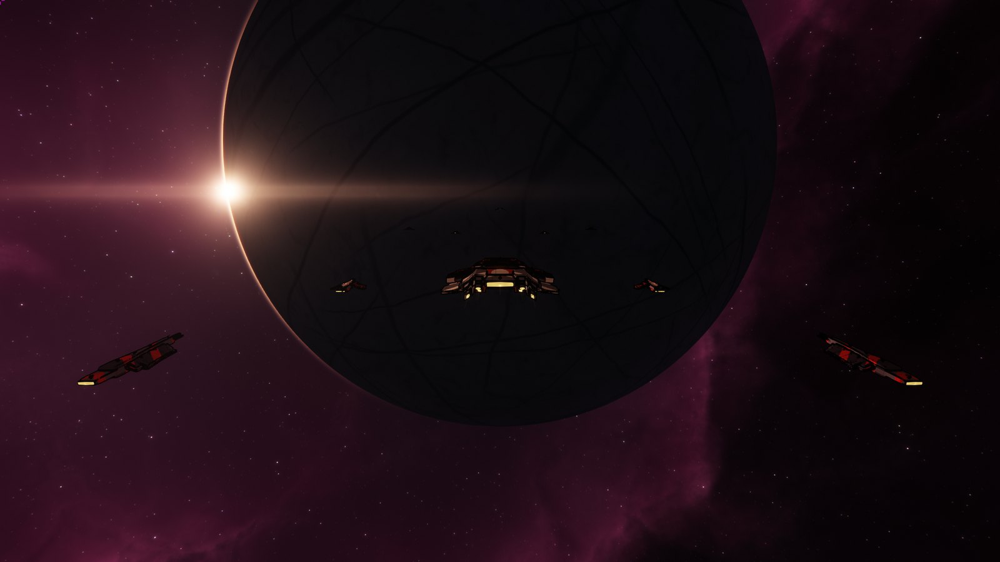

It is built on the old C++ Limit Theory engine, and it is a work in progress. The systems are playable from end to end; the ships, stations and sounds are still first passes. Its drawn art is in a retro-anime manner: the character portraits, the splash, and two cel-shaded looks the game can be played in.

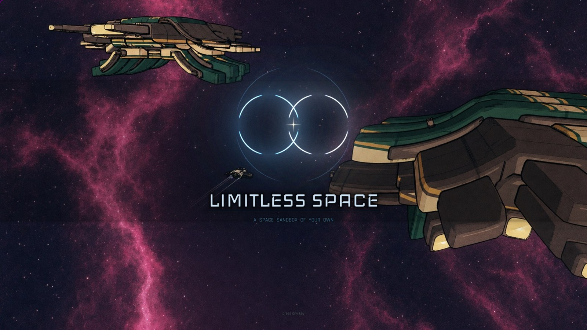

*The pictures here are taken in the Cel V2 look.*

| | |
|---|---|
| 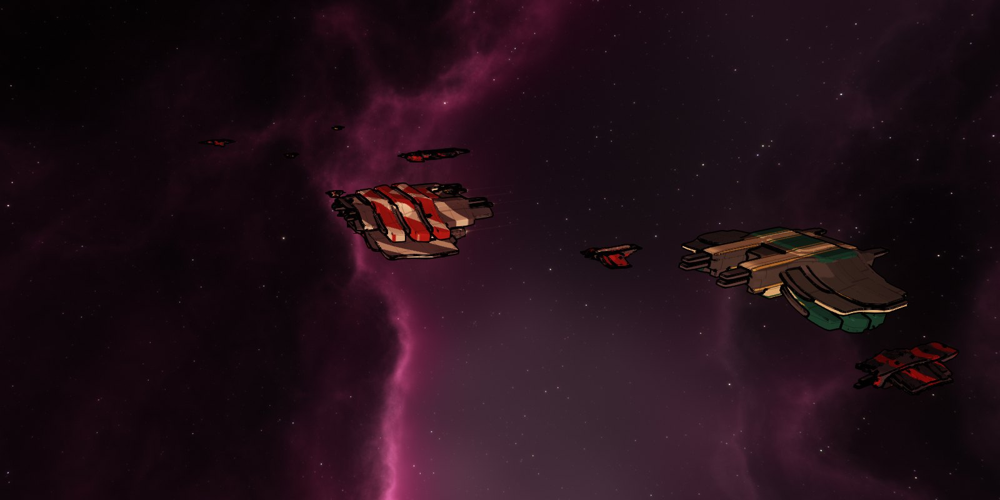 | 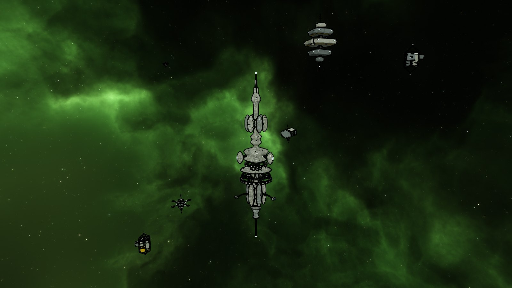 |
| A battleship in its owner's paint, with escorts and a carrier | A station is a tower with modules anchored round it |
| 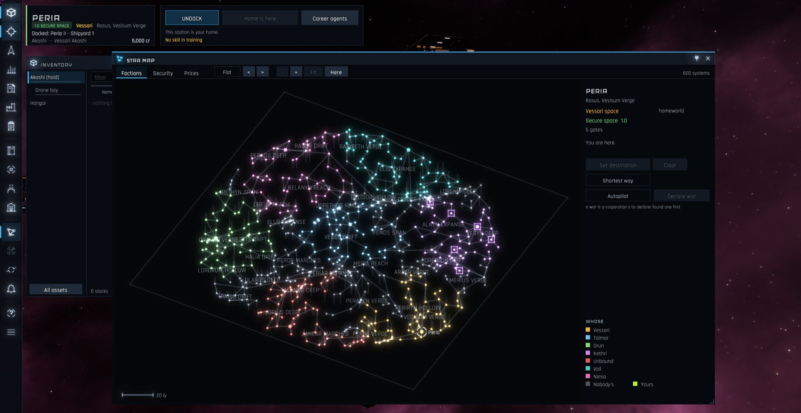 | 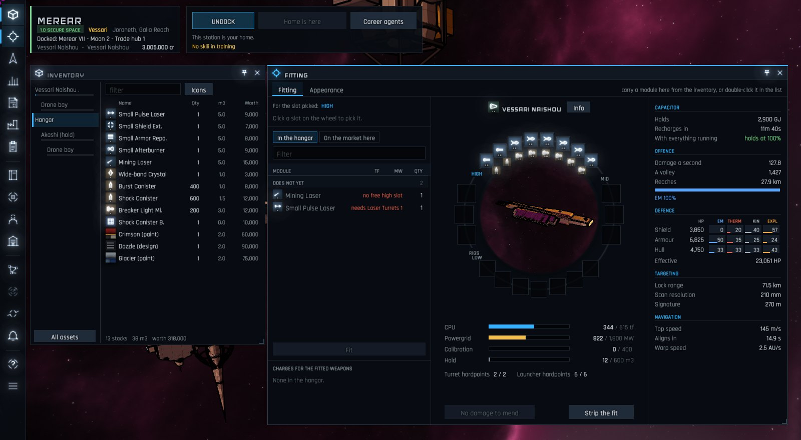 |
| The star map: six hundred systems, coloured by who holds them | Fitting: the ship is shown as it is in space |
| 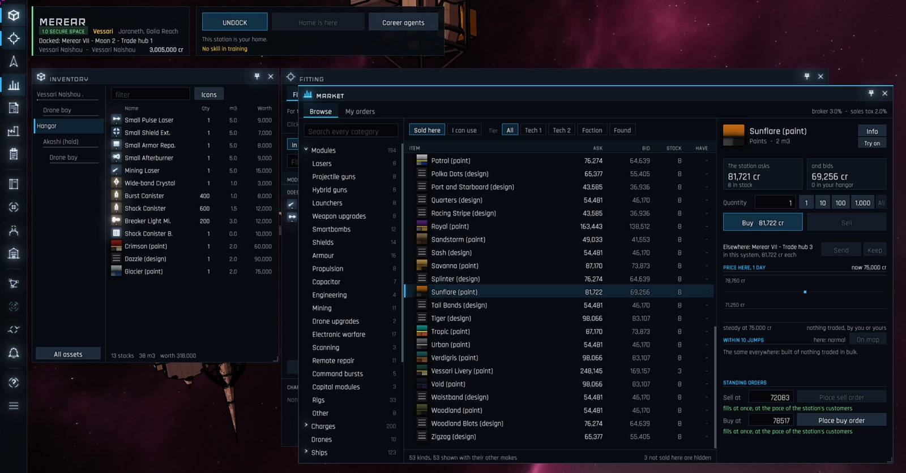 | 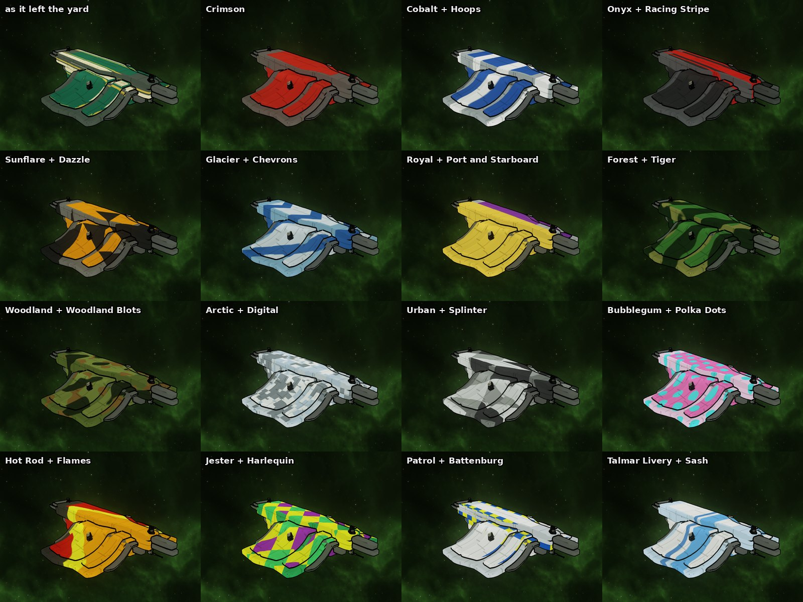 |
| Paints and designs are bought on the market, and can be tried on first | One cruiser, sixteen coats: plain, camouflage, gaudy, police and a livery |

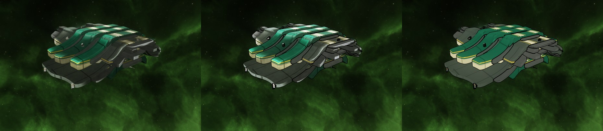

*One battleship in the three looks (Options, Graphics): Standard, and the two cel-shaded ones, Cel V1 over the worn paint and Cel V2 with the paint laid on flat. The cel looks are for what is built (ships, stations, towers); rock, ice, planets and the sky stay as they are.*

## What is in the game

- **Flight by orders**: approach, orbit, keep at range, align, warp, dock, jump through gates, with an autopilot and a star map.
- **Ships and fitting**: frigates to battleships, haulers and capitals for four human peoples, the pirates and the aliens, with turrets, launchers, drones, electronic warfare, cloaks, rigs and tech 2; and smartbombs, micro jump drives, interdiction bubbles, tractor beams, remote repair and capacitor, energy neutralisers and nosferatu, command bursts, siege, triage and industrial cores, jump drives and the beacons they jump to, ship, cargo and survey scanners, and each human people's own line of modules.
- **Better gear to find**: custom and masterwork modules in pirate wrecks, each people's own make for those in good standing with them, named officers who carry modules of their own, and mutators that throw a module's figures again, for better or worse.
- **Combat**: target locking, tracking and range, shields, armour and hull, wrecks to loot and salvage, insurance, and a capsule to get home in.
- **Industry**: mining ore, ice and gas, refining, manufacturing from blueprints, research and invention, moon mining and reactions, and planetary colonies.
- **Trade**: a market at each station with buy and sell orders, over an economy of real materials that moves along the gates, with shortages, convoys and prices that differ by who owns the station.
- **Things to do**: career agents who show a new pilot the ropes, daily jobs, combat camps, mining and courier contracts, standings and loyalty stores, sites to scan down, derelicts to hack, and space no chart shows on the far side of wormholes.
- **A world that moves**: the peoples fight wars over open space and systems change hands; pirates mass where order is thin; invasions come out of the deep; rare captains, traders and derelicts are sighted; gates close and rich belts are found. An events window and the star map say what is going on.
- **Characters**: pilots kept outside any one game, each with a name, a portrait and skills that train in real time, all of them at once and while the game is closed; a character can be taken into a new galaxy, and the others asked into its corporation as members. A galaxy keeps what was earned in it: the wallet, ships, items, implants and standings.
- **Company**: hired pilots who follow, mine, haul, patrol and guard; a corporation of your own with members who work for themselves and pay it a tax; starbases of your own, and systems claimed in your name.
- **Paint**: paints and designs for your ship (camouflage, gaudy, police, and plain), bought on the market, tried on before you buy, yours for good once bought, and switched between on the fitting screen. Each human faction has a livery its own ships fly in, sold to pilots it thinks well of.
- **Saves**, music, and sound.

## The ship generator

Most hulls in the game are grown from a seed by the engine's old ship generator, which has ten styles to grow them in, any of them with its two sides alike or not. `bin/launch hulls` goes through seeds by hand, and `script/hulls` makes sheets of them, in any of the looks. The stations' towers are grown the same way, in eight styles of their own: `bin/launch towers` goes through those, and `script/towers` makes sheets of them.

| | |
|---|---|
| 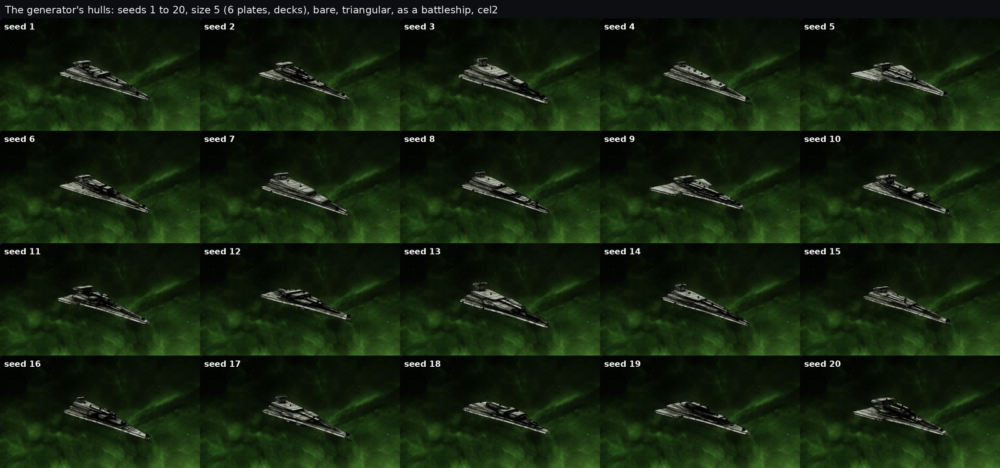 | 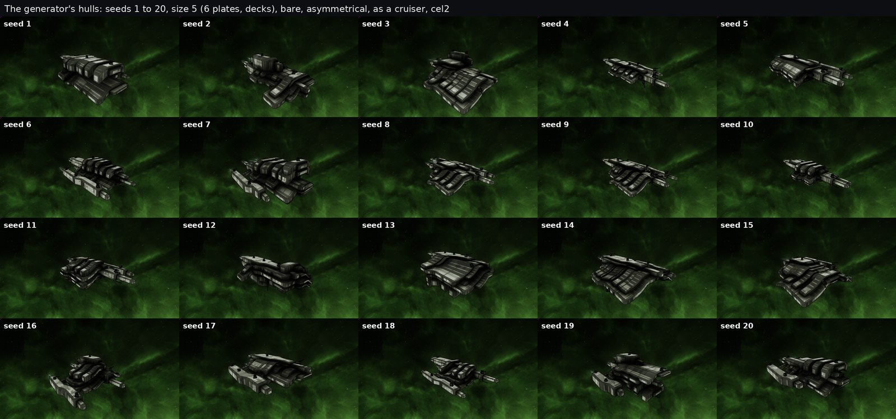 |
| The triangular style, as battleships | The asymmetrical style, as cruisers |

Towers are grown the same way and stood on end: 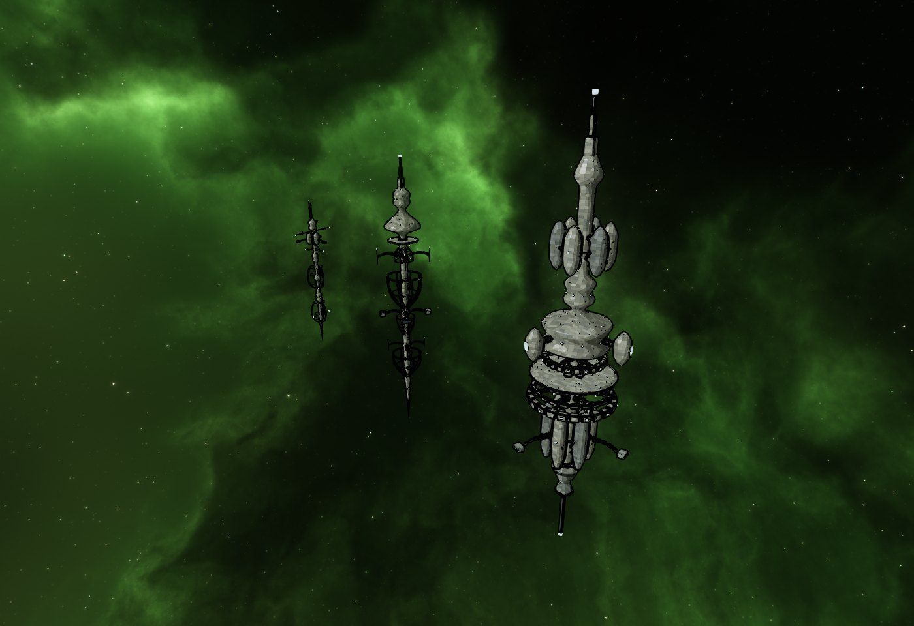

## Where this comes from

This is a fork of the old C++ implementation of Limit Theory, its engine (LTE) and its scripting language, written by Josh Parnell from 2012 to 2015 and released into the public domain. What has changed in this fork:

- The scripts are [Luau](https://luau.org) (typed Lua); the engine's own scripting language is gone. See `docs/luau.md`.
- It builds and runs on 64-bit Linux, and is cross-built for Windows.
- There is a new game on top of the engine (`bin/launch game`). All of its state and rules live in a deterministic, engine-free Luau core, and the engine draws what the core says. The old prototype is still there as `bin/launch ltheory`.

`docs/roadmap.md` has the plan and, at its top, what is built so far. `RELEASE_NOTES.md` says what each release brought.

## Requirements

64-bit Linux is what this fork is built and tested on (Ubuntu, GCC 15, CMake 4.2, Mesa). A Windows build is cross-compiled from Linux with MinGW-w64 (`script/build-windows`); building on Windows itself, as the original did with Visual Studio, has not been tried here.

On Debian or Ubuntu:

```sh
sudo apt install build-essential cmake python3 git-lfs libglew-dev libglu1-mesa-dev \
  libfreetype-dev libx11-dev libxrandr-dev libudev-dev libgl-dev
```

To run the checks (not needed to play): `sudo apt install sway xwayland python3-pil`. The scripted play-throughs draw on a hidden desktop that `sway` provides; without it they fall back on `xvfb-run`, which is much slower.

Audio goes through the vendored miniaudio, so no audio libraries are needed. With no audio device the game runs silently.

## Getting the source

The art, fonts and sounds are stored with Git LFS, and SFML and Luau are submodules. Install LFS before cloning, or most resources will be broken in ways that are hard to recognise.

```sh
git lfs install
git clone --recursive <this repository's URL> ltheory
cd ltheory
```

## Building

```sh
python3 configure.py          # generate the build files (CMake)
python3 configure.py build    # compile; the first time takes a while
```

This leaves three programs in `bin/`: `launch` (runs an app in a window), `ltcore` (runs engine-free scripts with no window) and `luaucheck` (the type checker). Scripts are read at start, so changing a `.luau` file needs no rebuild.

## Playing

```sh
bin/launch game
```

On a laptop with two graphics cards, `DRI_PRIME=1 bin/launch game` runs it on the faster one.

The game opens on a splash (any key sends it on) and then a menu that shows who you are playing as: Continue (that character's newest game), Characters and games, Options and Quit. Characters and games is one screen: your characters down the left, and on the right the one picked, their games grouped by universe and a new game (pick a seed and a galaxy size); New character opens a pane for a name and one of the portraits, or a picture of your own. Options has sound on or off, the loudness of effects and music, the keys, how the window opens, the size of the interface, and a Graphics page with the Look (Standard, Cel V1 or Cel V2) and a switch for each stage the picture is made in. A new game starts you docked at a station with a small ship. That station has five career agents (the Careers tab), who each teach a way of making a living in a few short lessons and pay for them; the Guide button lists everything else there is to do, and shows the lessons you have in hand while you are in space.

| | |
|---|---|
| Left click | Select something in space or on the overview |
| Right click | A menu of what can be done about it, with distances for orbit, keep at range and warp |
| Double click (overview) | Approach it, or warp to it if it is far off |
| Double click (in space) | Fly the way the cursor points; on a bracket, as on its row of the overview |
| Left drag, mouse wheel | Turn the camera, zoom |
| Q, W, E, A | Approach, orbit, keep at range, align |
| S, D | Warp to, dock or jump |
| L, Tab | Lock or unlock, pick the next hostile ship |
| F1 to F12 | Switch the fitted modules on and off |
| Space | Stop |
| C, M | Camera follows what is selected, the star map |
| P, Escape | Pause, the menu |
| F9, F10 | Quick save, quick load |

Docking saves the game. Saves and settings are kept in `save/`, which git ignores.

## Other apps and tools

`bin/launch <name>` runs `resource/script/App/<name>.luau`. Besides `game` there are the old prototype (`ltheory`) and the original demos and tools, among them `war`, `dogfight`, `rails`, `observatory`, `model`, `platemesh` and `map`.

| | |
|---|---|
| `script/check` | Says whether the tree is healthy: type check, engine-free specs, about thirty-five scripted play-throughs of the game, and screenshot comparisons. It takes about a quarter of an hour. Its fifty or so windows are opened where nobody sees them (`script/offscreen`); `--on-desktop` shows them, and `--fast` skips everything that needs one. |
| `bin/luaucheck` | Type-checks every script in strict mode. |
| `bin/ltcore Tool/specs` | Runs the engine-free test suites. |
| `script/viewer` | One window for looking at hulls, stations, planets and effects, and for taking pictures of them. |
| `script/offscreen` | Runs a command that opens windows on a desktop of its own with no screen (a headless `sway`, on the same graphics card). A scripted or hidden run of `bin/launch` goes through it by itself. |
| `script/soundgen` | Makes the game's own sounds and music from the written descriptions in `resource/sound/made/sounds.txt`, and a listening page for a batch. |
| `script/artgen` | Redraws a picture of the game's (a hull as the viewer shows it, a posed fleet) in the retro-anime manner with OpenAI's image service, keeping its shape: square icons, or art such as the splash. What it makes is kept in `cache/artgen` until it is looked at and taken into the game. |
| `script/modelgen` | Writes the hull models under `resource/model` (Wavefront OBJ, which Blender opens) from numbers. The game reads a hull from such a file, or from a binary glTF (`.glb`) made anywhere. |

`docs/tools.md` covers these and the rest, and `docs/harness.md` the scripted harness the play-throughs use.

## Where things are

| | |
|---|---|
| `resource/script/Core/` | The game: all state and rules, engine-free and deterministic (`docs/design/core.md`) |
| `resource/script/Game/` | What the player sees and hears: the scene, the interface, sound and music |
| `resource/script/App/` | The apps, `game.luau` among them |
| `resource/script/Tool/` | Engine-free tools: the spec runner, the simulation runs |
| `src/` | The engine (`liblt`), the launcher, `ltcore` and `luaucheck` |
| `resource/` | Shaders, fonts, textures, sounds, and the hull models that are read from files |
| `test/` | Scripted play-throughs (`scenario/`) and stored screenshots (`golden/`) |
| `docs/` | The roadmap, design notes, and a catalogue of the old codebase |
| `ext/`, `extbin/`, `extlib/` | Third-party code and libraries |

## Sound and music

The original engine's sounds are in `resource/sound`. The sounds and music under `resource/sound/made` were generated from text descriptions with ElevenLabs' sound-effect and music services, by `script/soundgen`; the descriptions are kept beside them in `sounds.txt`.

Nothing is needed to play them. Making new ones needs an ElevenLabs API key in the environment or in a `.env` file at the top of the repository (`ELEVENLABS_API_KEY=...`), which git ignores, and spends credits on that account. In the same way `script/artgen` needs an OpenAI key (`OPENAI_API_KEY=...`). `NOTICE.md` says where each kind of asset comes from.

## Licence

The code, and everything it makes, is in the public domain (see `LICENSE`). Some files came from elsewhere and keep their own terms: third-party code, the fonts, and some of the original engine's sounds. `NOTICE.md` says which.
